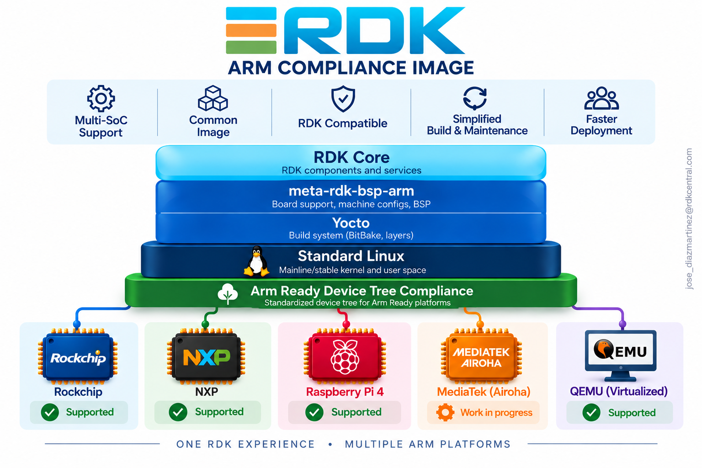
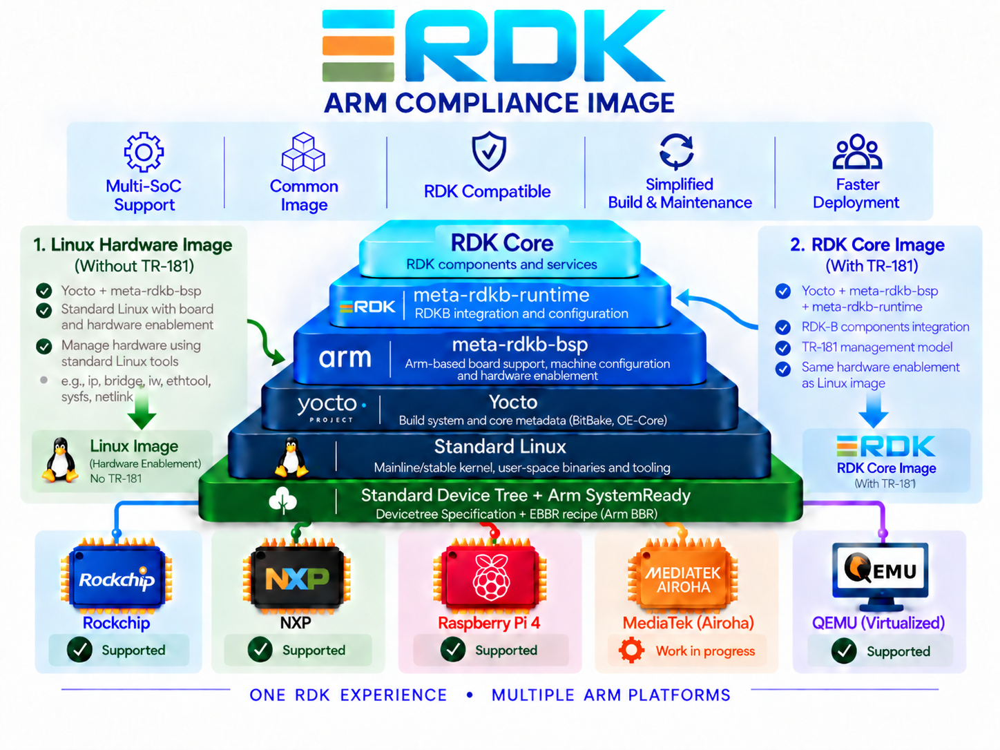
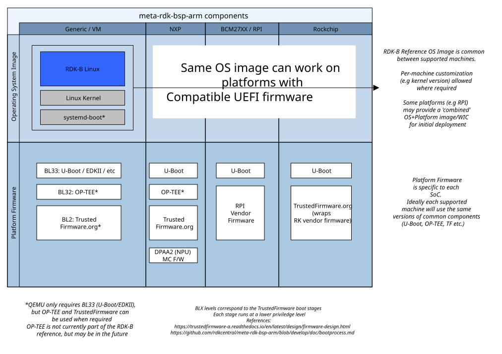

# RDK-B Reference BSP for Arm SystemReady

This Yocto BSP layer builds a portable RDK-B operating system image for supported boards and virtual machines that implement [Arm SystemReady](https://www.arm.com/architecture/system-architectures/systemready-certification-program).

Other compatible hardware may also boot the image, with support on a best-effort basis. The layer uses only community-maintained upstream sources, including the Linux kernel from kernel.org.

## Arm SystemReady introduction

Arm SystemReady gives RDK-B a common firmware-to-OS interface. Firmware uses UEFI to boot the operating system and, on Device Tree-based platforms, describes the board hardware to Linux. This common boot flow reduces board-specific integration work and lets the same RDK-B image boot across supported platforms.

## Table of contents

- [Arm SystemReady introduction](#arm-systemready-introduction)
- [Architecture and platform integration](#architecture-and-platform-integration)
- [Build environment](#build-environment)
- [How to use](#how-to-use)
- [Build outputs](#build-outputs)
- [Building platform firmware for different hardware types](#building-platform-firmware-for-different-hardware-types)
- [Running the generated image](#running-the-generated-image)
- [Hardware Support Table](#hardware-support-table)
- [Image management and upgrades on generic Arm](#image-management-and-upgrades-on-generic-arm)
- [Development Notes](#development-notes)

## Architecture and platform integration

### Problem solving

#### What is RDK?

RDK is an open-source software platform used by major service providers including Comcast, Charter, Vodafone, and Deutsche Telekom.

It provides a common middleware and service orchestration layer for customer premises equipment, enabling operators to manage, integrate, and evolve platform services consistently across device families.

RDK provides a common software platform for two device families.

- RDK-B broadband gateways
- RDK-V video platforms

#### RDK Management goals

RDK Management focuses on the following areas.

- Platform technical evolution
- Portability
- Lifecycle management
- Hardware reference platforms
- Reduction of SoC integration friction

#### Portability challenge

Arm SoCs can differ in several areas.

- Boot chains that include ROM, TF-A, U-Boot, or proprietary loaders.
- Hardware descriptions that depend on board-specific Device Trees, kernel patches, or vendor SDK configurations.
- Different firmware packaging, storage layouts, flashing tools, and update mechanisms.
- Different levels of upstream driver support and proprietary dependencies.

Adding a new SoC can require custom work across several parts of the stack.

- firmware
- bootloader
- kernel
- device tree
- image layout
- upgrade flow

**Arm SystemReady provides a common firmware-to-OS contract that greatly reduces platform-specific adaptation.**

### Arm SystemReady building blocks

| Component | Purpose |
|-----------|---------|
| BSA | Defines the minimum Arm hardware baseline |
| Devicetree | Standard hardware description |
| BBSR | Secure Boot and authenticated firmware updates |
| EBBR | UEFI firmware-to-OS contract |
| Common Boot Flow | Common OS boot sequence |

### Key principles

- Standardize firmware-to-OS handoff
- Integrated security
- Avoid proprietary boot methods
- Simplify boot flow
- Improve portability

### Benefits for RDK-B

- Silicon portability — Encourages SoC vendors to meet a common Arm hardware baseline, reducing platform-specific assumptions in RDK-B.
- Firmware–OS interoperability — Defines a consistent firmware-to-OS interface through EBBR/UEFI, so RDK-B can use a common boot flow across SoCs.
- Security consistency — Provides an industry-standard model for Secure Boot and authenticated firmware updates through BBSR.
- Standard OS update and rollback flow — Enables the OS to request the next boot target through standard UEFI boot variables and boot-management mechanisms, supporting A/B updates, recovery, and rollback.
- Trusted firmware updates — Enables authenticated board-firmware updates using standard UEFI Capsule Update services, where the platform supports the SystemReady Security Extension.
- Portable RDK-B OS image — Uses firmware-provided Device Tree hardware descriptions, allowing one RDK-B image to support multiple compliant platforms while keeping board-specific hardware configuration in firmware.

### Firmware-to-OS contract

#### Firmware and hardware responsibilities

The firmware shall provide a standard firmware-to-operating-system contract aligned with Arm SystemReady, including the required EBBR-based UEFI boot behavior.

The firmware has the following responsibilities on Device Tree-based platforms.

* Implementing the EBBR-required subset of UEFI.

  * Boot Services
  * Runtime Services
  * Required UEFI protocols
  * Standard boot manager behavior
* Exposing the hardware description through a valid Device Tree Blob (DTB) passed via the UEFI Configuration Table.
* Providing the UEFI memory map and the standard boot environment required to launch EFI applications.
* Following the standard boot sequence shown below.

```
Firmware
    ↓
EFI Bootloader / UKI
    ↓
Linux Kernel
    ↓
ExitBootServices()
    ↓
Linux uses the Device Tree provided by firmware
```

#### Operating system expectations

The operating system relies on standard firmware interfaces.

* The bootloader can be started through standard UEFI boot entries (`BootOrder`, `BootNext`, EFI executable paths).
* The kernel uses the firmware-supplied Device Tree to discover CPUs, memory, interrupt controllers, timers, buses, and board peripherals.

This gives the operating system image a common boot path. The same RDK-B image can run on multiple Arm SystemReady platforms when the kernel includes the required drivers and Device Tree bindings.

### Proposed boot chain

```
ROM / SoC Boot Code
        ↓
Board Firmware / U-Boot
        ↓
systemd-boot
        ↓
Linux Kernel + initramfs + Device Tree (or UKI)
        ↓
Linux Userspace
```

#### Design principles

* U-Boot performs board initialization and provides firmware services.
* `systemd-boot` selects the boot entry.
* A single portable RDK-B image can boot on multiple supported platforms.

### meta-rdk-bsp-arm

[meta-rdk-bsp-arm repository](https://github.com/rdkcentral/meta-rdk-bsp-arm)

#### Purpose

`meta-rdk-bsp-arm` is the RDK-B reference BSP meta-layer used to build portable SystemReady/UEFI-based operating system images and integrate board firmware for supported targets.

##### Current strategy

* Self-contained implementation that uses `meta-arm` as a reference for firmware, QEMU, and machine setup.
* Provides greater implementation flexibility
* Reduces dependency-alignment effort

<a href="doc/rdk-arm-generic-current.png">
  
</a>

##### Long-term layering strategy

To align with the upstream Arm SystemReady Yocto ecosystem, we plan to split `meta-rdk-bsp-arm` into two Yocto layers.

- `meta-rdkb-bsp` will own board support and all Linux platform dependencies required by RDK-B, including machine configurations, board firmware, the Linux kernel, and system packages.
- `meta-rdkb-runtime` will be dedicated to RDK-B components and their Yocto recipes and runtime configuration. These components will run on the Linux platform provided by the BSP layer.

<a href="doc/rdk-arm-generic-evolution.png">
  
</a>

Where possible, `meta-rdkb-bsp` will build on the following Arm-provided Yocto support.

- `meta-arm`
- `generic-arm64` / `genericarm64`
- SystemReady-related support available in the `meta-arm` repository

### Requirements from SoC vendors

#### Required deliverables

##### Firmware

- SystemReady / EBBR compliant firmware
- UEFI firmware image
- Trusted Firmware-A (TF-A)
- U-Boot (or equivalent bootloader)
- Secure Boot support (when available)

##### Hardware description

- Device Tree source files (`.dts`)
- Device Tree include files (`.dtsi`)
- Compiled Device Tree Blobs (`.dtb`)
- Device Tree bindings
- Documentation of supported board variants

##### Linux enablement

- Supported upstream Linux kernel version
- Kernel configuration fragments
- Required platform patches
- Vendor drivers
- Peripheral firmware for the following components as applicable
  - Wi-Fi
  - Bluetooth
  - GPU
  - DSP
  - NPU
  - Ethernet PHY

##### Board assets

- Flashing tools
- Firmware update packages
- Recovery procedures
- Storage layout documentation

#### Documentation

##### Boot architecture

- Boot chain description from Boot ROM to the operating system
- Description of all firmware components (TF-A, U-Boot, EDK II, OP-TEE, etc.)
- Firmware storage locations
- Firmware update process
- Boot architecture diagrams (recommended)

##### UEFI boot behavior

- BootOrder implementation
- BootNext support
- Fallback boot behavior
- EFI boot entries
- Supported boot devices
- Known platform-specific limitations

##### Arm SystemReady compliance

- SystemReady compliance level
- EBBR capabilities
- BBSR capabilities
- Compliance evidence or certification reports
- Known deviations or limitations

##### Device Tree and Linux support

- Supported Device Tree files
- Supported board variants
- Required kernel version
- Required kernel configuration
- Upstream driver status
- Known missing functionality

##### Security

- Secure Boot key provisioning process
- Signing requirements for operating system images
- Signing requirements for firmware images
- Rollback protection model
- Firmware update authentication model
- Recovery model

##### Integration guidance

- How to boot a generic EFI/SystemReady operating system
- How to integrate the platform with Yocto
- Guidance for other Linux distributions
- Required proprietary firmware blobs or packages
- Reference board setup
- Flashing procedures
- Recovery procedures
- Troubleshooting guide

### Collaboration model

#### SoC vendor proposed ownership

* Deliver a SystemReady Device Tree compliant firmware stack.
* Perform hardware bring-up.
* Maintain UEFI / EBBR firmware.
* Enable Secure Boot where supported.
* Deliver validated Device Trees.
* Maintain platform-specific drivers and firmware.

#### RDK Management proposed ownership

* Maintain the reusable Yocto integration.
* Provide machine configurations.
* Maintain the common Linux kernel baseline.
* Build EFI bootable RDK-B images.
* Maintain a common upgrade strategy.
* Provide validation and lifecycle management across supported platforms.

#### Arm current ownership

- Define and maintain the Arm SystemReady specifications.
- Define the EBBR and BBSR compliance requirements.
- Maintain the Base System Architecture (BSA) specifications.
- Provide reference firmware implementations and tooling where applicable.
- Define and evolve the firmware-to-operating-system contract.
- Operate the SystemReady compliance and certification program.

#### Arm proposed contribution

- Provide guidance on the recommended use of `meta-arm`, `generic-arm64`, and SystemReady-related Yocto support.
- Help identify gaps between the upstream Arm Yocto ecosystem and broadband gateway requirements.
- Review the `meta-rdk-bsp-arm` layering strategy and suggest alignment points with upstream Arm layers.
- Support technical sync-ups to discuss missing functionality, integration blockers, and possible upstream improvements.
- Advise on SystemReady, EBBR, BBSR, and firmware-to-OS contract interpretation.
- Help define what should remain RDK-specific and what could be contributed or aligned upstream.
- Provide feedback on how `meta-arm` could better support broadband-oriented use cases.

### Final goal

#### RDK Management

* Define the Yocto release.
* Define the Linux kernel baseline.
* Maintain kernel configuration.
* Integrate common upstream fixes.
* Maintain RDK-B integration.

#### SoC Vendors

* Upstream or port SoC drivers.
* Provide Device Tree bindings.
* Deliver compatible DTBs.
* Supply unavoidable vendor patches.
* Validate the platform against the agreed kernel baseline.

#### Arm

- Provide guidance on the recommended use of `meta-arm`, `generic-arm64`, and SystemReady-related Yocto support.
- Help identify gaps between the upstream Arm Yocto ecosystem and broadband gateway requirements.
- Clarify SystemReady, EBBR, and BBSR expectations for broadband-oriented platforms.
- Support alignment between `meta-rdk-bsp-arm` and the upstream Arm SystemReady ecosystem.
- Advise on what should remain RDK-specific and what could be aligned or contributed upstream.
- Provide feedback on platform compliance evidence, known deviations, and integration limitations.

### Objective

Provide a portable, reusable, and maintainable RDK-B platform where responsibilities between RDK Management and SoC vendors are clearly separated through the Arm SystemReady firmware-to-operating-system contract.

## Build environment

**Debian 12** is the recommended distribution for building `meta-rdk-bsp-arm`.

AppArmor on hosts such as Ubuntu 24.04 can cause BitBake failures even when the build runs in a container based on another distribution. The traceback can look like this.

```text
Traceback (most recent call last):
  File "/build/openembedded-core/bitbake/bin/bitbake-worker", line 268, in child
    bb.utils.disable_network(uid, gid)
  File "/build/openembedded-core/bitbake/lib/bb/utils.py", line 1653, in disable_network
```

These references describe the issue and possible workarounds.

* [Workaround for uid_map error on Ubuntu 24.04](https://lists.yoctoproject.org/g/yocto/topic/workaround_for_uid_map_error/106192359)
* [Ubuntu bug #2056555: Allow bitbake to create user namespace](https://bugs.launchpad.net/ubuntu/+source/apparmor/+bug/2056555)

On high core/thread count machines, an issue with Yocto 5's perl package may cause build failures like:

```text
libgomp: Thread creation failed: Resource temporarily unavailable
```

The workaround for this issue is to manually set the maximum number of threads for certain
operations:

```
echo 'OMP_NUM_THREADS="8"' >> "conf/local.conf"
echo 'BB_NUMBER_THREADS="16"' >> "conf/local.conf"
```

See issue [#162](https://github.com/rdkcentral/meta-rdk-bsp-arm/issues/162) for more information.

### Reference build container

This Dockerfile defines the reference build environment.

```dockerfile
FROM debian:12

RUN apt-get update && \
    apt-get install -y \
    gawk wget git diffstat unzip texinfo gcc \
    build-essential chrpath socat cpio python-is-python3 python3 python3-pip \
    python3-pexpect xz-utils debianutils iputils-ping python3-git \
    python3-jinja2 python3-subunit zstd liblz4-tool file locales libacl1 \
    qemu-utils curl && \
    apt-get clean && \
    localedef -i en_US -c -f UTF-8 -A /usr/share/locale/locale.alias en_US.UTF-8

RUN mkdir -p /usr/local/bin/ && \
    curl https://storage.googleapis.com/git-repo-downloads/repo -o /usr/local/bin/repo && \
    chmod +x /usr/local/bin/repo

RUN groupadd builder && \
    useradd \
        --create-home --home-dir /builder \
        --comment "Build user" \
        --gid builder --shell /bin/bash builder && \
    mkdir -p /builder/.ssh

RUN chown -R builder:builder /builder

WORKDIR /builder
USER builder
```

## How to use

The manifest files are now published in the [rdkb-manifest](https://github.com/rdkcentral/rdkb-manifest)
repository on GitHub.

```
$ mkdir rdkb-arm
$ cd rdkb-arm
$ repo init -u 'https://github.com/rdkcentral/rdkb-manifest/' \
    -m "rdkb-arm.xml" \
    -b "develop"
$ repo sync
$ source meta-rdk-bsp-arm/setup-environment
$ bitbake rdk-generic-broadband-image
```

**ATTENTION**: The `develop` branch in the repo command above
will pull the rolling development version of RDK-B.

For the current "release" version, please switch to the `main`
branch in this repository and follow the instructions mentioned
there.

If you need to enable features such as unified-wifi-mesh/EasyMesh, you can do this
by creating the `conf/distro/include/local-settings.inc` (under your local
copy of `meta-rdk-bsp-arm`), like so:

```
echo 'DISTRO_FEATURES:append:broadband = " EasyMesh"' >> conf/distro/include/local-settings.inc
```

At the current time, the `main` branch mainfest will build RDK-B 2025Q1 (based on Yocto `kirkstone`),
and will be updated following the next major RDK-B release.

The `develop` branch is intended to follow `rdk-next` as closely as possible.

## Build outputs



There are two types of build outputs:

* The _platform firmware_, which abstracts the hardware platform in a standard manner (the SystemReady standards).

* The _operating system image_, which includes the root filesystem, Linux kernel and boot manager.
  
  Development images generated by this layer can be used across any machine which has a compatible _platform firmware_ deployed.

The default `armefi64-rdk-broadband` machine type will generate an _operating system image_
that will be bootable on platforms with SystemReady (EFI) compatible firmware **and** a
_platform firmware_ firmware which can be used with QEMU's arm64 
[`virt`](https://qemu-project.gitlab.io/qemu/system/arm/virt.html) machine type.

The following generated binaries (in `build-armefi64-rdk-broadband/tmp/deploy/images/armefi64-rdk-broadband/`) are relevant:

* `rdk-generic-broadband-image-armefi64-rdk-broadband.wic`: Uncompressed operating system image (kernel + rootfs + boot manager)
  
  This image can be booted on a board (or virtual machine) which already has SystemReady compatible firmware
* `rdk-generic-broadband-image-armefi64-rdk-broadband.wic.qcow2`: QCOW2 operating system image, best to use with virtual machine programs
* `rdk-generic-broadband-image-armefi64-rdk-broadband.tar.gz`: Compressed tar archive of the operating system image (including kernel). See [Image management and upgrades on generic Arm](#image-management-and-upgrades-on-generic-arm) for upgrade instructions.
* `u-boot-armefi64-rdk-broadband.bin` (linked to `u-boot.bin`): Reference _platform firmware_ (used with QEMU `virt` machine)

The generated disk (wic) images are intended for block storage devices, for example,
eMMC, SD cards, USB or NVMe storage devices, or emulated types such as `virtio-blk`.

A production device may use flash (NOR or NAND) devices for storing the system level firmware.

Additional files like `Image` (Linux kernel Image file), `linuxaa64.efi.stub` (Kernel EFI stub),
`systemd-bootaa64.efi` (systemd-boot executable) and `u-boot-initial-env-armefi64-rdk-broadband`
(U-Boot "Factory" environment) are also generated by the Yocto build process.
These are not needed for normal development and deployment activities.

It is intended that the `rdk-generic-broadband-image-armefi64-rdk-broadband.wic` is a _universal_
operating system image that will boot on as many real and virtual machines as possible.

(For example, you can write the `.wic` file onto a USB drive, and move the USB
drive between different boards without making any changes)

Where possible, the same Linux kernel, firmware (U-Boot) and other relevant
component versions will be used, with a strong preference for "mainline" versions.

For further information, see [Real hardware](#real-hardware), [Development Notes](#development-notes), and the [Boot Process for generic Arm systems](doc/bootprocess.md).

## Building platform firmware for different hardware types

Many development boards will not have a SystemReady-compatible firmware pre-loaded,
or the pre-loaded firmware will be out of date.

To provide an easier developer experience, this meta-layer can build the platform
firmware for several common developer boards.

Once you have deployed the SystemReady-compatible _platform firmware_ to your board,
you will not need to replace it and only need to consider updating your
_operating system image_.

This meta layer can generate firmware for the following types of hardware,
with more planned to be implemented (see the [Hardware Support Table](#hardware-support-table)).

Board Name              | `MACHINE` identifier          | multiconfig nickname  |
------------------------|-------------------------------|-----------------------|
Generic QEMU            | `armefi64-rdk-broadband`      | `generic`             |
Raspberry Pi 3/4 64-bit | `raspberrypi64-rdk-broadband` | `raspberrypi`         |

The default `MACHINE` is `armefi64-rdk-broadband` (as explained above).

To generate an image for another machine, specify the `MACHINE` environment
variable when sourcing `setup-environment`:

```
MACHINE="raspberrypi64-rdk-broadband" source meta-rdk-bsp-arm/setup-environment
```

All machine configurations for RDK-B inherit from `armefi64-rdk-broadband`.

Unless the machine configuration has specific overrides, the operating system image
(kernel + rootfs + boot manager) generated by configurations like `raspberrypi64-rdk-broadband`
will be identical to that of the generic machine. **Only the _platform_ firmware binaries will be different**.

### Configuring multiconfig for multiple target builds

It is possible to use BitBake's ["multiconfig"](https://docs.yoctoproject.org/5.0.9/dev-manual/building.html#building-images-for-multiple-targets-using-multiple-configurations)
feature to setup the same build folder for multiple targets at once.

Doing so will save you time and disk space, as most packages between
machines defined in this layer are shared.

If you specify `MACHINE=all`, the `setup-environment` script will do the necessary setup:

```
$ MACHINE="all" source meta-rdk-bsp-arm/setup-environment
```

You can then run the build cycle for each target:

```
$ bitbake mc:generic:rdk-generic-broadband-image && \
    bitbake mc:raspberrypi:rdk-generic-broadband-image
```

(Due to the way RDK-B components are built, it is not possible to do
a "parallel" build for two targets at once, however, you will still
save a significant amount of time and disk space by using multiconfig
builds sequentially)

Build images for each target will be available in `tmp/deploy`:

```
$ ls build-armefi64-rdk-broadband/tmp/deploy/images/
armefi64-rdk-broadband
raspberrypi64-rdk-broadband
```

## Running the generated image

### QEMU (Arm64 virtualized or emulated)

#### Method 1: Yocto runqemu

The Yocto machine files are setup to boot the VM with `runqemu`.

This setup is not as flexible as other methods, but it allows quick verification
that the built image is working.

Note that you will require `sudo` access for `runqemu` to setup the networking connection
between host and guest.

```
$ runqemu nographic

matt@build:/home/matt/rdkb-cmf-arm/build-armefi64-rdk-broadband$ runqemu nographic
runqemu - INFO - Running bitbake -e ...
runqemu - INFO - Continuing with the following parameters:
MACHINE: [armefi64-rdk-broadband]
FSTYPE: [wic.qcow2]
ROOTFS: [/home/matt/rdkb-cmf-arm/build-armefi64-rdk-broadband/tmp/deploy/images/armefi64-rdk-broadband/rdkb-generic-broadband-image_rdk-next_20241029112121.rootfs.wic.qcow2]
CONFFILE: [/home/matt/rdkb-cmf-arm/build-armefi64-rdk-broadband/tmp/deploy/images/armefi64-rdk-broadband/rdkb-generic-broadband-image_rdk-next_20241029112121.qemuboot.conf]
...
U-Boot 2024.07 (Jul 01 2024 - 18:07:18 +0000)
....
EFI stub: Booting Linux Kernel...
EFI stub: Using DTB from configuration table
EFI stub: Exiting boot services...
[    0.000000] Booting Linux on physical CPU 0x0000000000 [0x410fd034]
[    0.000000] Linux version 5.15.68-yocto-standard (oe-user@oe-host) (aarch64-rdk-linux-gcc (GCC) 11.3.0, GNU ld (GNU Binutils) 2.38.20220708) #1 SMP Wed Sep 21 20:06:51 UTC 2022
...
Welcome to RDK (A Yocto Project based Distro) 2.0 (kirkstone)!
...
RDK (A Yocto Project based Distro) 2.0 armefi64-rdk-broadband ttyAMA0

armefi64-rdk-broadband login: root (automatic login)
```

Under the runqemu configuration, the LAN side interface will be available to the host
as the `tapX` interface, while the WAN interface will use QEMU's Userspace emulation.

#### Method 2: Direct QEMU invocation

You can use the generated `wic.qcow2` and `u-boot.bin` to invoke QEMU directly.
This allows you to customize your QEMU setup for your own environment and requirements.

On virtualization capable Arm64 hosts you can use KVM for near-native performance.

You can invoke QEMU like this:

```
# Copy the QCOW2 image and u-boot.bin from the deploy directory
cp $HOME/rdkb-cmf-arm/build-armefi64-rdk-broadband/tmp/deploy/images/armefi64-rdk-broadband/{rdk-generic-broadband-image-armefi64-rdk-broadband.wic.qcow2,u-boot.bin} .

# It can be helpful to create a snapshot to quickly revert
# any changes that are made
qemu-img create -f qcow2 -b rdk-generic-broadband-image-armefi64-rdk-broadband.wic.qcow2 -F qcow2 rdk.snapshot.qcow2
# And resize that snapshot to allow space for upgrades
qemu-img resize rdk.snapshot.qcow2 10G

DISK=${DISK:-rdk.snapshot.qcow2}
sudo qemu-system-aarch64 -nographic \
    -cpu cortex-a53 -machine virt \
    -bios u-boot.bin \
    -smp 2 -m 1024 \
    -device virtio-rng-pci \
    -hda "${DISK}" \
    -netdev tap,id=testlan -net nic,netdev=testlan \
    -netdev tap,id=testlan2 -net nic,netdev=testlan2 \
    -netdev user,id=testwan -net nic,netdev=testwan \
    -device pci-serial
#using bridge manager:
# ensure /usr/local/libexec/qemu-bridge-helper is present and executable
# provide /usr/local/etc/qemu/bridge.conf:
#     allow br10
#     allow br100

sudo qemu-system-aarch64 -nographic \
    -cpu cortex-a53 -machine virt \
    -bios u-boot.bin  \
    -smp 2 -m 1024  \
    -device virtio-rng-pci  \
    -hda "${DISK}"  \
    -netdev bridge,id=testwan,br=br10 \
    -device virtio-net pci,netdev=testwan,mac=52:54:00:2d:6e:99  \
    -netdev bridge,id=testlan,br=br100 \
    -device virtio-net-pci,netdev=testlan,mac=52:54:00:2d:6e:98  \
    -device pci-serial
```

On native Arm64 platforms with virtualization, enable KVM by replacing `-cpu cortex-a53` with `-cpu host --enable-kvm`.

#### QEMU frontends (UTM.app, virt-manager etc.)
See the [doc/virtualization](doc/virtualization) folder for information on using various QEMU frontend programs (like UTM.app and virt-manager).

### Real hardware
A benefit of the SystemReady architecture is being able to use the same images
on virtual machines and bare-metal hardware.

Note that images generated by this reference layer SHOULD boot on SystemReady compatible
hardware, but hardware and vendor specific features like LED configurations, hardware
dataplanes and SoC-specific WiFi integrations are not included in this layer.

See [Building platform firmware for different hardware types](#building-platform-firmware-for-different-hardware-types)
for the targets that this layer can build firmware for. Other boards may require
firmware from the vendor or a downstream layer.

You can write the `wic` image directly to your boot device. See the [Hardware Support Table](#hardware-support-table) for tested boards and their firmware requirements.

### Usage Notes

* This layer is configured to use WanManager exclusively.

  There is no `erouter0` interface.
  Some components that do not function without `erouter0`, like WebUI,
  are not currently included.

  The WAN interface name is board specific (`eth1` on the generic Arm machine,
  `eth0` on Raspberry Pi, `eth6`/`eth2` on Ten64) and is configured through
  `dmsb.wanmanager.if.1.Name` in the matching `ccsp-psm-machine-configs` file.

* USP (`usp-pa`) is the only management agent built into the image by default.

  WebPA (parodus) and Telemetry 2.0 are opt-in and configured in `conf/distro/include/local-settings.inc`:

  ```
  DISTRO_FEATURES:append = " webpa"
  DISTRO_FEATURES:append = " t2"
  ```

* The `armefi64-rdk-broadband` machine image is a _universal_ image which can be booted
  on any supported board (provided the board already has a working UEFI firmware).

  On first boot it will attempt to find a matching PSM defaults file for the hardware
  (matched by the device-tree `compatible` string, or DMI Board information for ACPI hosts)
  if not, a "default" configuration will be applied which adds `eth0` to the LAN bridge
  and uses `eth1` as the WAN interface.

  Please see this [pull request](https://github.com/rdkcentral/meta-rdk-bsp-arm/pull/174#issue-5242719768)
  for details about the `ccsp-psm-machine-configs` mechanism.

  If you build an image for a specific platform such as `raspberrypi64-rdk-broadband`, it will
  only contain the defaults file for that specific platform.

#### SSIDs, Passwords and other configuration settings

WiFi SSIDs will be setup with the following settings:

```
phy#1
        Interface wlan1
                ifindex 22
                wdev 0x100000001
                addr 00:0a:52:08:34:c5
                ssid RDKB-AP1
                type AP
                channel 44 (5220 MHz), width: 80 MHz, center1: 5210 MHz
                txpower 23.00 dBm
phy#0
        Interface wlan0
                ifindex 21
                wdev 0x1
                addr 00:0a:52:08:34:c4
                ssid RDKB-AP0
                type AP
                channel 1 (2412 MHz), width: 20 MHz, center1: 2412 MHz
                txpower 17.00 dBm
```

These correspond to the `private_ssid_` configurations in RDK-B's WiFi configuration.
Other WiFi SSIDs (such as IoT and Hotspot) are currently disabled due to a driver issue.

The default WiFi passwords are sourced from `/nvram/wifi_defaults.txt` (sourced from
`meta-rdk-broadband/recipes-ccsp/ccsp/files/wifi_defaults.txt` inside this repository).

You can change the WiFi password with these dmcli commands:

```
dmcli eRT setv Device.WiFi.AccessPoint.1.Security.KeyPassphrase string 'new_wifi_password'
dmcli eRT setv Device.WiFi.AccessPoint.2.Security.KeyPassphrase string 'new_wifi_password'
dmcli eRT setv Device.WiFi.ApplyAccessPointSettings bool true true
```

In the future there will be a standardized method to derive/source 'default' WiFi credentials
on supported devices.

To use a cellular modem, you will need to set `dmsb.cellularmanager.profile.default.apn` in the
PSM database to your operator's internet APN.

**Users of this repository should ensure all default settings (such as passwords) are changed**

No credentials outside the scope of the gateway are stored inside this repository, any references
to external services are placeholder/test values only.

## Hardware Support Table

### Current platform support

#### Supported platforms

`meta-rdk-bsp-arm` provides machine configurations and integrates board firmware for the targets it builds.

Platforms with existing SystemReady-compatible firmware, such as EDK II under QEMU, can use the EFI-bootable operating system artifacts directly.

#### SystemReady-compliant platforms without a machine configuration

A compliant platform may be able to boot the portable RDK-B image using the vendor's firmware. To add support for that platform to this layer, follow these steps.

1. Obtain the vendor firmware.
2. Add a machine configuration.
3. Integrate the platform into `meta-rdk-bsp-arm`.

### Notes

* RDK-B is configured to use the serial console as the main system console, most HDMI and LCD screen drivers are disabled in the kernel configuration.
   * Therefore, you will need a USB-serial adapter/cable for boards which do not provide console access directly
* Boards that only have 1xEthernet port (like the Raspberry Pi) require a USB Ethernet adapter for the "LAN" side interface. (The built-in Ethernet will be configured for WAN usage).

    These are not intended as production-quality targets, and are generally used for kernel and firmware level testing only
* Some SOM (System on Module) boards have "client" or "IoT"-type WiFi/BT modules, in most instances these chipsets/modules are not supported.

    Only full "AP" solutions like the MT7915/6 series are supported for WiFi.

### Support levels

_This is simply an estimation of how much testing and development activity the platform is exposed to, it does not constitute a formal SLA or endorsement._

* Tier 1: Built and tested often
* Tier 2: Built and tested occasionally (e.g regression testing kernel changes)
* Tier 3: Only tested once in a while (reasons include: limited access to hardware, only 3rd party reports etc.)

### Firmware Source

* Meta-layer: `meta-rdk-bsp-arm` has a machine type for this machine and can generate board-level firmware for it
* External: You need to obtain and install the SystemReady/EFI-compatible firmware from elsewhere (usually the vendor) first
* Platform: This platform has a SystemReady/EFI-compatible firmware built in (e.g virtualization programs using EDK-II), and we do not see the need to provide any customization for it

When there is an asterisk `*` marked in this column, it is planned to integrate firmware generation into `meta-rdk-bsp-arm` in the near future.

### By SoC Vendor

#### NXP

| Name and Image | SoC | Ethernet | WiFi | 4G/5G | Firmware Source | Support Level |
| --- | --- | --- | --- | --- | --- | --- |
| [Traverse Technologies Ten64](https://www.traverse.com.au/hardware/ten64) | [Layerscape LS1088A](https://www.nxp.com/products/LS1088A) | 8x1G + 2xSFP+ | Yes, with MT7915/6 | Yes, with RM5XX module | Platform\* | Tier 1 |
| Ten64 (RDK development variant) | [Layerscape LS1088A](https://www.nxp.com/products/LS1088A) | 4x1G + 2xSFP+ | Yes (MT7916) | Yes (RM520N-GL) | External\* | Tier 1 |

#### Raspberry Pi (including CM4/5 based boards)

| Name and Image | SoC | Ethernet | WiFi | 4G/5G | Firmware Source | Support Level |
| --- | --- | --- | --- | --- | --- | --- |
| [52Pi Router Board + CM4](https://52pi.com/products/52pi-raspberry-pi-compute-module-4-cm4-router-board) | BCM2711 | 2x1G | No | Not supported | Meta-layer | Tier 2 |
| Raspberry Pi 4 | BCM2711 | 1x1G\* | Not supported | Not supported | Meta-layer | Tier 3 |

#### Rockchip

| Name and Image | SoC | Ethernet | WiFi | 4G/5G | Firmware Source | Support Level | Application Note |
| --- | --- | --- | --- | --- | --- | --- | --- |
| [MYIR MYD-LR3568](https://en.myir.cn/RK3568/148.html) | [RK3568](https://www.rock-chips.com/a/en/products/RK35_Series/2021/0113/1276.html) | 2x1G | None | TBD | External\* | Tier 3 | [RK3568 User Guide](https://github.com/rdkcentral/meta-rdk-bsp-arm/wiki/RK3568-User-Guide) |

### Virtual Machines

| Name and Image | SoC | Ethernet | WiFi | 4G/5G | Firmware Source | Support Level | Application Note |
| --- | --- | --- | --- | --- | --- | --- | --- |
| qemu-system-aarch64 + U-Boot | Virtual | 3x1G | No | No | Meta-layer | Tier 1 | [Direct QEMU invocation](#method-2-direct-qemu-invocation) |
| [Incus](https://linuxcontainers.org/incus/) (Virtual Machine Mode) | Virtual | 2x1G | No | No | Platform | Tier 1 | Incus Agent will be automatically installed when run as a guest, to allow introspection of RDK-B VMs from the host |
| [UTM](https://mac.getutm.app/)<br/>_macOS only_ | Apple M-series | Up to 3x1G | No | No | Platform | Tier 2 | [utm-vm.md](doc/virtualization/utm-vm.md) |
| GNS3 | Virtual | Up to 3x1G | No | No | Meta-layer | Tier 2 | [gns3.md](doc/virtualization/gns3.md) |
| virt-manager | Virtual | Up to 3x1G | No | No | Platform | Tier 2 | [Command line/virsh](doc/virtualization/virt-manager.md)<br/>[GUI](doc/virtualization/virt-manager-gui-setup.pdf) |

### Working USB Ethernet adaptors

| Brand | Model | Chipset / Driver |
| --- | --- | --- |
| U-GREEN | [FBA_20256](https://eu.ugreen.com/products/ugreen-usb-to-ethernet-adapter-usb-3-0-to-rj45-1gbps-lan-network-adapter-gigabit-ethernet-adaptor-plug-and-play-for-macbook-pro-2022-2021-2020-2019-pixelbook-switch-chromebook-tv-box-steam-deck)<br/> _USB3.0-A to Ethernet (Black)_ | CDC-NCM (ASIX Chipset) |

## Image management and upgrades on generic Arm

The generic Arm layer (`meta-rdk-bsp-arm`) uses Btrfs snapshots to manage image versions.

This approach is modeled on the [Snapper](https://documentation.suse.com/smart/systems-management/html/snapper-basic-concepts/index.html) system used by [microOS](https://microos.opensuse.org/) and similar systems such as Fedora CoreOS.

### Advantages

1. Allows rollback to previous image versions.
2. Avoids repartitioning and writing raw disk images during upgrades, reducing disk wear.
3. Uses native Btrfs snapshots for read-only system images.
4. Integrates with Arm EFI and SystemReady boot flows. The basic implementation works on platforms with the required firmware features. Platforms with additional EFI features can support deeper integration.

### Implementation

#### Subvolumes

A running system uses three kinds of subvolumes.

* `/nvram` mounts the top-level `@nvram` subvolume by default. A boot entry can select an image-specific `/nvram` snapshot using `nvramvol`.
* `/rdklogs` mounts the shared top-level `@rdklogs` subvolume.
* Each system image can have a writable subvolume such as `@image-1743555485` and a read-only snapshot such as `@image-1743555485-ro`.

The systemd unit `btrfs-subvolume.service` runs `/lib/rdk/btrfs/nvram-subvol-init.sh` to mount `/nvram` and `/rdklogs` at boot. The script first checks whether it needs to grow the root partition and filesystem, for example after copying a raw image to a larger SSD.

The example below shows the subvolumes for two installed images.

```text
root@armefi64-rdk-broadband:~# btrfs subvolume list /
ID 256 gen 9 top level 5 path srv
ID 257 gen 89 top level 5 path @nvram
ID 258 gen 13768 top level 5 path @rdklogs
ID 259 gen 155 top level 5 path @image-1743555485
ID 260 gen 84 top level 5 path @image-1743555485-ro
ID 263 gen 153 top level 5 path @image-1743557516
ID 264 gen 152 top level 5 path @image-1743557516-ro
```

#### Boot

Each installed image has a systemd-boot entry under `/boot/loader/entries`. Development systems can also have an explicit read-write entry.

```text
root@armefi64-rdk-broadband:~# ls -l /boot/loader/entries/
total 28
-rwxr-xr-x 1 root root 195 Apr  2 00:58 boot-1743555485-rw.conf
-rwxr-xr-x 1 root root 192 Apr  2 00:58 boot-1743555485.conf
-rwxr-xr-x 1 root root 195 Apr  2 01:32 boot-1743557516-rw.conf
-rwxr-xr-x 1 root root 192 Apr  2 01:32 boot-1743557516.conf
-rwxr-xr-x 1 root root 195 Apr  4 05:20 boot-1743744044-rw.conf
-rwxr-xr-x 1 root root 192 Apr  4 05:20 boot-1743744044.conf
-rwxr-xr-x 1 root root 134 Apr  5  2011 boot.conf
```

Each loader entry contains the image title, the path to its kernel on the `/boot` partition, and the kernel command line.

```text
root@armefi64-rdk-broadband:~# cat /boot/loader/entries/boot-1743555485.conf
title boot-1743555485
linux /Image-1743555485
options LABEL=Boot root=PARTUUID=799b2dd6-06fc-43a8-91f8-2ad47410bdef rootwait rootfstype=btrfs rootflags=subvolid=260 net.ifnames=0 nvramvol=261
```

The kernel uses `rootflags=subvolid=...` to mount the image's root subvolume. The `nvramvol` parameter selects the corresponding `/nvram` subvolume.

#### Installing new images

The `efi-image-manager` utility installs new operating system images from a `.tar.gz` archive. It creates a subvolume, extracts the archive into it, and copies the included kernel to the `/boot` partition. It then creates a bootloader entry without changing the default. Select the new image from the systemd-boot menu on the next boot.

```text
root@rdkb-arm:/tmp# efi-image-manager import rdk-generic-broadband-image-armefi64-rdk-broadband.tar.gz
CliArgs { cmd: Import { image: "rdk-generic-broadband-image-armefi64-rdk-broadband.tar.gz" } }
Image path: (rdk-generic-broadband-image-armefi64-rdk-broadband.tar.gz)
Extract status: exit status: 0
imagename:rdkb-generic-broadband-image_rdkb-2025q1-kirkstone_20250829024447
BRANCH=rdkb-2025q1-kirkstone
YOCTO_VERSION=kirkstone
VERSION=rdkb-2025q1-kirkstone.08.29.25
SPIN=0
BUILD_TIME="2025-08-29 02:44:47"
JENKINS_JOB=Default
JENKINS_BUILD_NUMBER=0
Generated on Fri Aug 29  02:44:47 UTC 2025

RootFsImageInfo { image_name: "rdkb-generic-broadband-image_rdkb-2025q1-kirkstone_20250829024447", version: "rdkb-2025q1-kirkstone.08.29.25", build_time: "\"2025-08-29 02:44:47\"" }
Image timestamp: 20250829024447
Full extract status: exit status: 0
Remounting /boot as read-write
"/volumes/toplevel/@root_20250829024447/boot/Image"
/nvram already a subvolume, creating a snapshot
Need to create: /boot/loader/entries/rdkb-generic-broadband-image_rdkb-2025q1-kirkstone_20250829024447.conf
Mounting boot as read-only again
```

The kernel and metadata for each imported image are stored under `/boot/rdkb`. The metadata records the subvolume IDs used to remove an obsolete image and its associated snapshots.

```text
root@rdkb-arm:/tmp# ls -la /boot/rdkb/
total 32
drwxr-xr-x 5 root root  4096 Aug 29 05:01 .
drwxr-xr-x 6 root root 16384 Jan  1  1970 ..
drwxr-xr-x 2 root root  4096 Apr 28  2022 rdkb-generic-broadband-image_rdkb-2025q1-kirkstone_20250829011801
drwxr-xr-x 2 root root  4096 Aug 29 02:19 rdkb-generic-broadband-image_rdkb-2025q1-kirkstone_20250829022008
drwxr-xr-x 2 root root  4096 Aug 29 05:01 rdkb-generic-broadband-image_rdkb-2025q1-kirkstone_20250829024447

root@rdkb-arm:/tmp# cat /boot/rdkb/rdkb-generic-broadband-image_rdkb-2025q1-kirkstone_20250829024447/image.json
{
  "image_name": "rdkb-generic-broadband-image_rdkb-2025q1-kirkstone_20250829024447",
  "root_volume_id": 266,
  "nvram_volume_id": 267,
  "read_write_volume_id": 265,
  "cmdline_extra": null
}
```

#### Bootloader menu


EFI variables could eventually bypass the systemd-boot menu. Automatic rollback after a failed upgrade is another possible extension.

## Development Notes

This layer is self-contained, it does not depend on any other layers for board support, however,
`meta-arm` (https://git.yoctoproject.org/meta-arm) has been used as the model for the firmware, QEMU
and machine setup.

For development purposes, there is both a "core" image type and a RDK-B image type:

* `armefi64`
   This is the "base" machine type that serves as a base. It does not import any RDK packages or
   configuration. When updating to newer Yocto project versions, use this
   machine for the initial porting (with Yocto image types like `core-image-minimal`).

* `armefi64-rdk-broadband`
   This is the RDK-B reference machine which inherits from `armefi64`

When adding another machine to the layer, it should inherit from `armefi64-rdk-broadband`.
